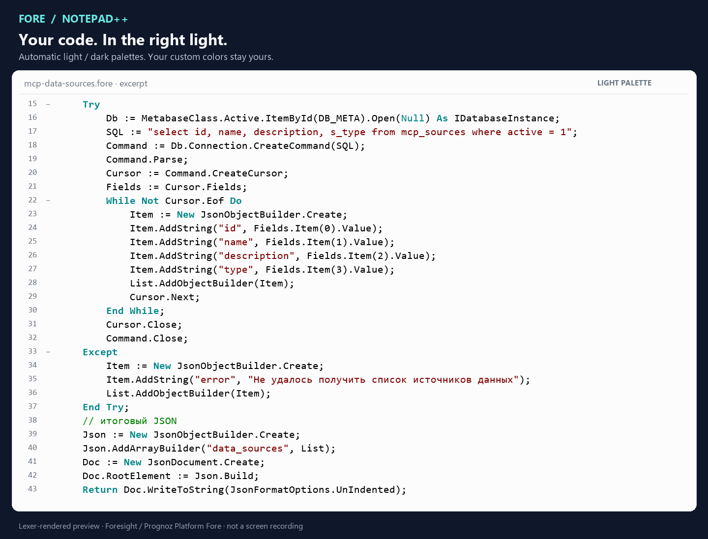
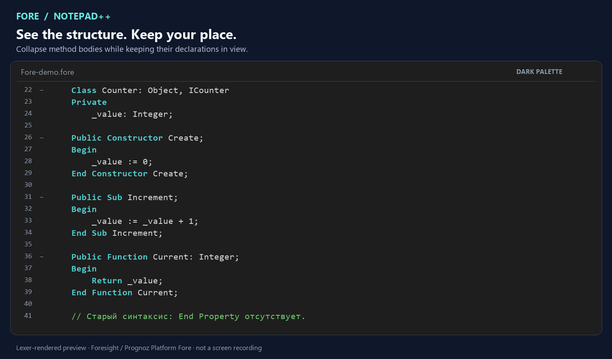

# Notepad++ Syntax Plugin for Foresight Platform Fore

[English](README.md) | [Русский](README.ru.md)

**Read Fore comfortably in the editor you already use.** Native syntax highlighting, folding and automatic light/dark palettes for **Foresight Platform Fore** and **Prognoz Platform Fore** in Notepad++.

[](https://github.com/rhyots/notepad-plus-plus-syntax-plugin-foresight-platform-fore/releases/tag/v1.1.0) [](https://github.com/rhyots/notepad-plus-plus-syntax-plugin-foresight-platform-fore/actions/workflows/build.yml) [](https://github.com/rhyots/notepad-plus-plus-syntax-plugin-foresight-platform-fore/releases/tag/v1.1.0) [](LICENSE)

[**Download for Notepad++ x64**](https://github.com/rhyots/notepad-plus-plus-syntax-plugin-foresight-platform-fore/releases/download/v1.1.0/NotepadPlusPlus-Syntax-Plugin-Foresight-Platform-Fore-1.1.0-x64.zip) · [**Download for Notepad++ x86**](https://github.com/rhyots/notepad-plus-plus-syntax-plugin-foresight-platform-fore/releases/download/v1.1.0/NotepadPlusPlus-Syntax-Plugin-Foresight-Platform-Fore-1.1.0-x86.zip) · [v1.1.0](https://github.com/rhyots/notepad-plus-plus-syntax-plugin-foresight-platform-fore/releases/tag/v1.1.0) · [User guide](docs/USER-GUIDE.md)

## Why use it?

Exported a Fore module? Reviewing a colleague's script? Opening an old Prognoz project? Give the code a structure you can read at a glance.

| What you need | What the plugin gives you |
|---|---|
| Read Fore without a wall of plain text | Keywords, strings, comments and types get their own styles |
| Navigate long modules | Fold classes, methods, properties, loops and conditional blocks |
| Switch from daytime to evening work | Light/dark palettes follow the editor background automatically |
| Keep your preferred appearance | Nonstandard custom colors and font settings stay yours |
| Open an exported `.txt` script | Conservative content detection can select Fore for eligible plain text |
| Use familiar editor controls | **Language → F → Fore** and **Style Configurator → Fore** |

Everything runs locally. Reading and highlighting files does not require a platform connection or an account.

## See it in action



**Light → dark → custom colors.** Black/gray text, teal keywords, green comments and red strings make different parts of the code easy to distinguish. The custom frame demonstrates a manual override; it is not a third automatic theme.

[Static light preview](docs/media/light.png) · [Static dark preview](docs/media/dark.png) · [Custom colors](docs/media/custom.png)



**Keep the outline, hide the detail.** Method folding begins at the declaration, so local variables belong to the method's fold too. Interface signatures and delegates do not create spurious method folds.

These are animated code previews rendered from the plugin's actual lexer results and XML palettes, **not screen recordings of Notepad++**. The first preview uses a real MIT-licensed Fore excerpt from [ForesightPlatform/fap_mcp_server](https://github.com/ForesightPlatform/fap_mcp_server), by Evgeny Bogdanov. [Source and visual provenance](docs/media/README.md).

## Start in three steps

1. Download the **[Windows x64 plugin ZIP](https://github.com/rhyots/notepad-plus-plus-syntax-plugin-foresight-platform-fore/releases/download/v1.1.0/NotepadPlusPlus-Syntax-Plugin-Foresight-Platform-Fore-1.1.0-x64.zip)** or **[x86 ZIP](https://github.com/rhyots/notepad-plus-plus-syntax-plugin-foresight-platform-fore/releases/download/v1.1.0/NotepadPlusPlus-Syntax-Plugin-Foresight-Platform-Fore-1.1.0-x86.zip)** from Release 1.1.0, matching **Notepad++ → ? → Debug Info → bitness**, and extract the entire archive. A 32-bit editor needs x86 even on 64-bit Windows.
2. Save your documents and close Notepad++. In **PowerShell 7**, from the extracted folder, run:

   ```powershell
   pwsh -File install.ps1 -NotepadDirectory 'C:\Program Files\Notepad++'
   ```

   Use an administrator PowerShell for Program Files. For portable Notepad++, pass the folder containing its EXE.
3. Open a `.fore` file. The language in the status bar should be **Fore**. You can also select **Language → F → Fore**.

Prefer copying files? Follow the [manual installation guide](docs/USER-GUIDE.md#manual-installation). No PowerShell is required for that method.

The installer backs up existing files and removes only the competing `.fore` association from old UDL definitions. **Plugins Admin listing is pending**; use the manual release ZIP for this version.

**Still seeing Normal Text?** An old Fore UDL can own the extension. Remove `fore` from its **Ext.** field, then reopen the file. [Troubleshooting](docs/USER-GUIDE.md#troubleshooting).

## What gets highlighted and folded

- **66 reserved words and 12 built-in types**, case insensitive and matched as whole identifiers.
- Strings, doubled quotes, character literals, codes such as `#1040`, numbers, exponents, constants and operators.
- `//`, `///` and `{ … }` comments; **11 style categories** available in Style Configurator.
- Classes, interfaces, namespaces, enums, methods, conditions, loops, `Select Case`, `Try` and `With`.
- New-style `Property … End Property` blocks and `Get`/`Set` bodies, with old-style declarations handled separately.
- **LF, CRLF and CR** line endings; there is no need to convert your scripts.

Try the [full syntax sample](examples/Fore-demo.fore), [folding edge cases](examples/Folding-edge-cases.fore) or the [real MCP source excerpt](examples/third-party/mcp-data-sources.fore). The third-party excerpt needs its original module context to run; it is included for reading and highlighting.

## Automatic detection, with you in control

Open or paste Fore into an eligible **Normal Text** document and the plugin can recognize it. Detection is limited to **`.txt`, extensionless files and new unsaved tabs**. It looks for matching named Fore blocks and ignores strings/comments; `Class`, `Begin` and `End` alone are insufficient.

Other extensions and languages are preserved. An explicit language choice, including Normal Text, takes priority until that document is closed. Checks wait 350 ms after editing and examine at most the first 128 KiB. Your text is never changed.

Short or incomplete snippets may need manual selection. [Try the TXT example](examples/Fore-autodetect-demo.txt) · [Detection guide](docs/USER-GUIDE.md#automatic-detection).

## Colors that fit your editor

| Role | Light | Dark on `#1E1E1E` |
|---|---|---|
| Text | `#000000` | `#D4D4D4` |
| Keywords | `#008787` | `#4FD1D1` |
| Comments | `#008000` | `#6EC76E` |
| Strings | `#800000` | `#F08080` |

The light palette was sampled from a supplied platform screenshot. The dark palette preserves the same roles, with a minimum calculated contrast of **6.43:1** on `#1E1E1E`. Sampled pixels do not establish the original IDE's exact RGB settings.

Standard colors follow the actual editor background, in both views and after restart. Nonstandard custom colors and font settings are preserved. Style Configurator shows the base XML; runtime theme following does not rewrite it. [Customize colors and fonts](docs/USER-GUIDE.md#colors-and-fonts).

## Compatibility and validation

| Component | Status |
|---|---|
| **Notepad++ 8.9.8.1 / Windows x64 and x86** | Built and integration-tested in the actual editor |
| **Prognoz Platform Fore 8.1** | Language rules grounded in 36 original help documents |
| Later Foresight Platform Fore releases | Not individually certified |
| Fore.NET and ARM64 | Not supported targets in this release |

The plugin uses ILexer5 (introduced in Notepad++ 8.4); **8.9.8.1 x64/x86 is the minimum tested version**. The plugin does not compile or execute platform programs.

Recorded checks: **53** core assertions, **104** detector assertions, **381** native integration assertions across 18 scenarios, **17** native detection scenarios, **40** theme checks, and automated release-tooling tests. The 381 integration assertions, 17 detection cases and 40 theme checks passed separately on **each architecture**. Native checks open the real Style Configurator and About dialogs. [Detailed test report](docs/TESTING.md) · [Machine-readable evidence](validation.json) · [Build workflow](https://github.com/rhyots/notepad-plus-plus-syntax-plugin-foresight-platform-fore/actions/workflows/build.yml).

## Questions before installing?

**Is this for Prognoz, Foresight, Fore or “Foree”?** This is a plugin for **Fore**, the language used by **Prognoz Platform (Прогноз)** and **Foresight Platform (Форсайт)**. “Foree” is a search spelling, not a separate supported language. Fore.NET is outside this release's scope.

**Is it a UDL?** It is a native external lexer DLL. It participates in the regular language menu and Style Configurator. Do not import its XML through “Define your language”.

**Can it replace the platform IDE?** It is for reading and editing code. It does not provide a compiler, debugger, IntelliSense or semantic/type checking. Individual `Case` branches do not have separate folds; analysis currently scans the whole document and caches the result.

**Is it official?** This is an independent community project. Foresight, Prognoz and Notepad++ do not endorse or maintain it.

## Documentation and development

- [User guide](docs/USER-GUIDE.md) / [Руководство пользователя](docs/USER-GUIDE.ru.md)
- [Installation details](docs/INSTALLATION.md) · [CHANGELOG](CHANGELOG.md)
- [Build, checks and publication](docs/RELEASING.md) · [Contributing](CONTRIBUTING.md)
- [Exact-byte LF/CRLF rules](docs/BYTE-STABILITY.md) · [Plugins Admin readiness](docs/PLUGINS-ADMIN-READINESS.md)
- [Report a reproducible issue](https://github.com/rhyots/notepad-plus-plus-syntax-plugin-foresight-platform-fore/issues/new/choose)

<details>
<summary>Build locally with Zig 0.13.0 or CMake</summary>

```powershell
pwsh -File build.ps1 -Zig 'C:\tools\zig-0.13.0\zig.exe'
pwsh -File test.ps1 -Zig 'C:\tools\zig-0.13.0\zig.exe'
python -m pip install -r requirements-dev.txt
python -m pytest -q tests/test_release_files.py tests/test_release_archive.py
```

DLL: `build/x64/ForeLexer.dll`. Add `-Architecture x86` for `build/x86/ForeLexer.dll`; use CMake `-A Win32` in a separate build directory for x86. SDK headers are vendored and pinned. CMake:

```powershell
cmake -S . -B build/cmake -A x64
cmake --build build/cmake --config Release
ctest --test-dir build/cmake -C Release --output-on-failure
```

`qa/run.ps1`, `qa/run-autodetect.ps1` and `qa/run-theme.ps1` test isolated editor copies. `tools/verify.py` rechecks saved snapshots; `tools/package.py` builds deterministic ZIPs with SHA-256 manifests. See the [quality review and its measurement boundaries](docs/UB-MODE-REVIEW.md).

</details>

## Downloads, author and license

[**Download 1.1.0**](https://github.com/rhyots/notepad-plus-plus-syntax-plugin-foresight-platform-fore/releases/tag/v1.1.0) · [Release notes](https://github.com/rhyots/notepad-plus-plus-syntax-plugin-foresight-platform-fore/releases) · [Source](https://github.com/rhyots/notepad-plus-plus-syntax-plugin-foresight-platform-fore)

Choose `*-x64.zip` or `*-x86.zip` for manual installation, the matching `*-plugins-admin-x64.zip` / `*-plugins-admin-x86.zip` for the catalog layout, or `*-source.zip` for the full source tree. Each asset has a SHA-256 sidecar. The explicit source ZIP preserves tested bytes; GitHub's automatic source download is not the Plugins Admin asset.

**[MIT License](LICENSE)** for original project code, documentation and examples. Third-party SDK/runtime components and the credited community excerpt retain their own licenses. [Third-party notices](THIRD_PARTY_NOTICES.md). Proprietary platform help and platform binaries are not distributed; documentation provenance is recorded in [sources.json](sources.json).

Created by **[Artyom Nikiforov (rhyots)](https://github.com/rhyots)**. If it helps your Fore workflow, a star makes the project easier for other Prognoz and Foresight developers to discover.
