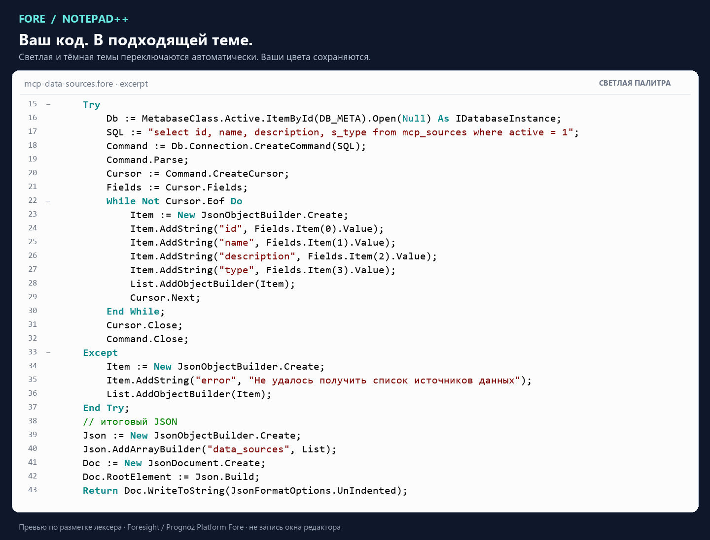
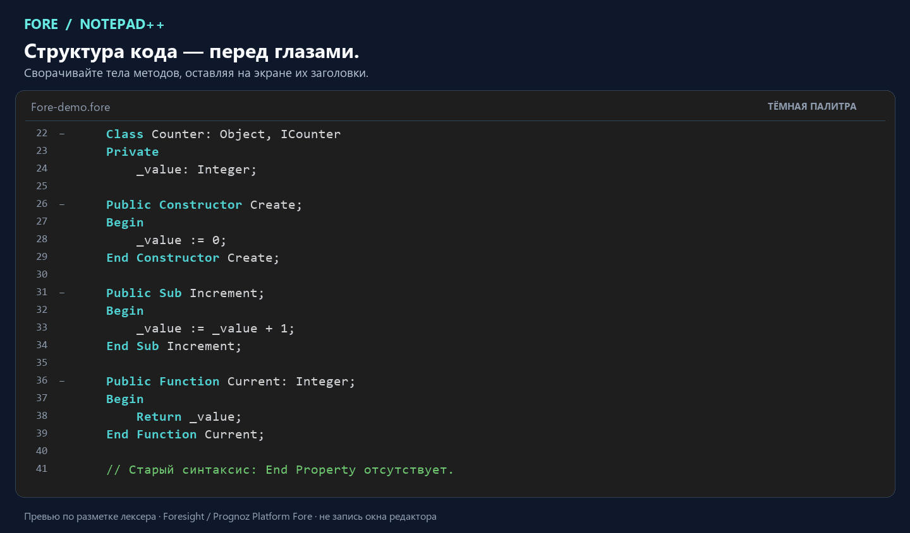

# Notepad++ Syntax Plugin for Foresight Platform Fore

[English](README.md) | [Русский](README.ru.md)

**Читайте Fore с комфортом в привычном редакторе.** Нативная подсветка, сворачивание и автоматические светлая/тёмная палитры для **Foresight Platform Fore** и **Prognoz Platform Fore** в Notepad++.

[](https://github.com/rhyots/notepad-plus-plus-syntax-plugin-foresight-platform-fore/releases/tag/v1.1.0) [](https://github.com/rhyots/notepad-plus-plus-syntax-plugin-foresight-platform-fore/actions/workflows/build.yml) [](https://github.com/rhyots/notepad-plus-plus-syntax-plugin-foresight-platform-fore/releases/tag/v1.1.0) [](LICENSE)

[**Скачать для Notepad++ x64**](https://github.com/rhyots/notepad-plus-plus-syntax-plugin-foresight-platform-fore/releases/download/v1.1.0/NotepadPlusPlus-Syntax-Plugin-Foresight-Platform-Fore-1.1.0-x64.zip) · [**Скачать для Notepad++ x86**](https://github.com/rhyots/notepad-plus-plus-syntax-plugin-foresight-platform-fore/releases/download/v1.1.0/NotepadPlusPlus-Syntax-Plugin-Foresight-Platform-Fore-1.1.0-x86.zip) · [v1.1.0](https://github.com/rhyots/notepad-plus-plus-syntax-plugin-foresight-platform-fore/releases/tag/v1.1.0) · [Руководство](docs/USER-GUIDE.ru.md)

## Зачем этот плагин?

Выгрузили модуль Fore? Проверяете скрипт коллеги? Открываете старый проект Прогноз? Сделайте структуру кода понятной с первого взгляда.

| Что вам нужно | Что даёт плагин |
|---|---|
| Читать Fore вместо сплошного текста | Отдельные стили ключевых слов, строк, комментариев и типов |
| Ориентироваться в длинных модулях | Сворачивание классов, методов, свойств, циклов и условий |
| Перейти от дневной работы к вечерней | Светлая и тёмная палитры автоматически следуют фону редактора |
| Сохранить привычное оформление | Нестандартные ручные цвета и настройки шрифта остаются вашими |
| Открыть выгруженный скрипт `.txt` | Осторожное автораспознавание может выбрать Fore для подходящего обычного текста |
| Пользоваться знакомыми настройками | **Синтаксисы → F → Fore** и **Конфигуратор стилей → Fore** |

Всё работает локально. Для чтения и подсветки файлов не требуется подключение к платформе или учётная запись.

## Посмотрите, как это выглядит



**Светлая → тёмная → свои цвета.** Чёрный/серый текст, бирюзовые ключевые слова, зелёные комментарии и красные строки помогают различать части кода. Кадр со своими цветами показывает ручную настройку, а не третью автоматическую тему.

[Светлая палитра без анимации](docs/media/light.ru.png) · [Тёмная палитра без анимации](docs/media/dark.ru.png) · [Свои цвета](docs/media/custom.ru.png)



**Оставьте структуру, скройте детали.** Сворачивание метода начинается с объявления, поэтому локальные переменные тоже входят в его блок. Сигнатуры интерфейсов и делегаты не создают ложных блоков методов.

Это анимированные превью кода, построенные по результатам настоящего лексера плагина и его XML-палитрам, **не видеозапись окна Notepad++**. В первом превью показан реальный Fore-фрагмент под MIT из [ForesightPlatform/fap_mcp_server](https://github.com/ForesightPlatform/fap_mcp_server), автор — Evgeny Bogdanov. [Источники кода и визуализаций](docs/media/README.ru.md).

## Начните с трёх шагов

1. Скачайте **[ZIP плагина для Windows x64](https://github.com/rhyots/notepad-plus-plus-syntax-plugin-foresight-platform-fore/releases/download/v1.1.0/NotepadPlusPlus-Syntax-Plugin-Foresight-Platform-Fore-1.1.0-x64.zip)** или **[ZIP x86](https://github.com/rhyots/notepad-plus-plus-syntax-plugin-foresight-platform-fore/releases/download/v1.1.0/NotepadPlusPlus-Syntax-Plugin-Foresight-Platform-Fore-1.1.0-x86.zip)** из выпуска 1.1.0, сверив разрядность в **Notepad++ → ? → Отладочная информация**, и полностью распакуйте архив. 32-разрядному редактору нужна x86 даже на 64-разрядной Windows.
2. Сохраните документы и закройте Notepad++. В **PowerShell 7**, из распакованной папки, выполните:

   ```powershell
   pwsh -File install.ps1 -NotepadDirectory 'C:\Program Files\Notepad++'
   ```

   Для Program Files запустите PowerShell от администратора. Для portable Notepad++ укажите папку с его EXE.
3. Откройте файл `.fore`. В строке состояния должен появиться язык **Fore**. Его также можно выбрать через **Синтаксисы → F → Fore**.

Предпочитаете скопировать файлы вручную? Есть [инструкция ручной установки](docs/USER-GUIDE.ru.md#ручная-установка). Для этого способа PowerShell не требуется.

Установщик сохраняет резервные копии и удаляет из старых определений UDL только конкурирующую привязку `.fore`. **Добавление в Plugins Admin ещё ожидается**; для этой версии используйте ZIP ручной установки.

**Всё ещё «Обычный текст»?** Расширение может быть занято старым UDL Fore. Удалите `fore` из его поля **Расш. / Ext.**, затем откройте файл заново. [Решение проблем](docs/USER-GUIDE.ru.md#решение-проблем).

## Что подсвечивается и сворачивается

- **66 ключевых слов и 12 встроенных типов**, без учёта регистра, с учётом границ идентификаторов.
- Строки, удвоенные кавычки, символьные литералы, коды вроде `#1040`, числа, экспоненты, константы и операторы.
- Комментарии `//`, `///` и `{ … }`; **11 категорий стилей** в Конфигураторе стилей.
- Классы, интерфейсы, пространства имён, перечисления, методы, условия, циклы, `Select Case`, `Try` и `With`.
- Новые свойства `Property … End Property` и тела `Get`/`Set`, с отдельной обработкой объявлений старого вида.
- Окончания строк **LF, CRLF и CR**; преобразовывать скрипты не нужно.

Попробуйте [полный пример синтаксиса](examples/Fore-demo.fore), [особые случаи сворачивания](examples/Folding-edge-cases.fore) или [реальный фрагмент MCP](examples/third-party/mcp-data-sources.fore). Для выполнения стороннего фрагмента нужен контекст исходного модуля; здесь он приведён для чтения и подсветки.

## Автораспознавание под вашим контролем

Откройте или вставьте Fore в подходящий документ с языком **«Обычный текст»**, и плагин сможет его распознать. Автораспознавание ограничено **`.txt`, файлами без расширения и новыми несохранёнными вкладками**. Оно ищет согласованные именованные блоки Fore и пропускает строки/комментарии; одних `Class`, `Begin` и `End` недостаточно.

Другие расширения и языки сохраняются. Явный выбор языка, включая «Обычный текст», имеет приоритет до закрытия документа. Проверка запускается через 350 мс после редактирования и рассматривает не более первых 128 КиБ. Текст не меняется.

Для коротких или неполных фрагментов может потребоваться ручной выбор. [Пример TXT](examples/Fore-autodetect-demo.txt) · [Руководство по распознаванию](docs/USER-GUIDE.ru.md#автораспознавание).

## Цвета, подходящие вашему редактору

| Роль | Светлая | Тёмная на `#1E1E1E` |
|---|---|---|
| Текст | `#000000` | `#D4D4D4` |
| Ключевые слова | `#008787` | `#4FD1D1` |
| Комментарии | `#008000` | `#6EC76E` |
| Строки | `#800000` | `#F08080` |

Светлая палитра взята с предоставленного снимка платформы. Тёмная сохраняет те же роли; минимальный расчётный контраст на `#1E1E1E` — **6,43:1**. Пиксели снимка не доказывают точные RGB-настройки исходной среды.

Стандартные цвета следуют фактическому фону редактора в обоих представлениях и после перезапуска. Нестандартные ручные цвета и настройки шрифта сохраняются. Конфигуратор показывает базовый XML; автоматическое переключение его не переписывает. [Настройка цветов и шрифтов](docs/USER-GUIDE.ru.md#цвета-и-шрифты).

## Совместимость и проверка

| Компонент | Состояние |
|---|---|
| **Notepad++ 8.9.8.1 / Windows x64 и x86** | Сборка и интеграционные проверки в настоящем редакторе |
| **Prognoz Platform Fore 8.1** | Правила языка основаны на 36 исходных документах справки |
| Поздние версии Foresight Platform Fore | По отдельности не сертифицированы |
| Fore.NET и ARM64 | Не являются поддерживаемыми целями этого выпуска |

Плагин использует ILexer5, появившийся в Notepad++ 8.4; **8.9.8.1 x64/x86 — минимальная проверенная версия**. Плагин не компилирует и не выполняет программы платформы.

Зафиксированы: **53** проверки ядра, **104** распознавателя, **381** нативной интеграции в 18 сценариях, **17** нативных сценариев распознавания, **40** проверок тем и автоматические тесты инструментов выпуска. 381 интеграционное утверждение, 17 сценариев распознавания и 40 проверок тем прошли отдельно **на каждой архитектуре**. Нативные проверки открывают настоящие окна Конфигуратора стилей и About. [Подробный отчёт](docs/TESTING.ru.md) · [Машиночитаемые результаты](validation.json) · [Сборка в GitHub Actions](https://github.com/rhyots/notepad-plus-plus-syntax-plugin-foresight-platform-fore/actions/workflows/build.yml).

## Вопросы перед установкой?

**Это для Прогноз, Foresight, Fore или «Foree»?** Это плагин для **Fore** — языка **Prognoz Platform (Прогноз)** и **Foresight Platform (Форсайт)**. «Foree» — вариант поискового написания, а не отдельный поддерживаемый язык. Fore.NET не входит в область этого выпуска.

**Это UDL?** Это нативный внешний лексер DLL. Он интегрируется в обычное меню языков и Конфигуратор стилей. Его XML не нужно импортировать через «Задать свой язык».

**Он заменяет среду платформы?** Плагин предназначен для чтения и редактирования кода. Компилятора, отладчика, IntelliSense и семантической проверки/проверки типов нет. Отдельные ветви `Case` не сворачиваются; пока анализируется весь документ с кешированием результата.

**Это официальный продукт?** Это независимый проект сообщества. Foresight, Prognoz и Notepad++ не заявляют его поддержку и не сопровождают его.

## Документация и разработка

- [Руководство пользователя](docs/USER-GUIDE.ru.md) / [User guide](docs/USER-GUIDE.ru.md)
- [Подробная установка](docs/INSTALLATION.ru.md) · [CHANGELOG](CHANGELOG.ru.md)
- [Сборка, проверки и публикация](docs/RELEASING.ru.md) · [Участие в разработке](CONTRIBUTING.ru.md)
- [Точные байты и LF/CRLF](docs/BYTE-STABILITY.ru.md) · [Готовность к Plugins Admin](docs/PLUGINS-ADMIN-READINESS.ru.md)
- [Сообщить о воспроизводимой проблеме](https://github.com/rhyots/notepad-plus-plus-syntax-plugin-foresight-platform-fore/issues/new/choose)

<details>
<summary>Локальная сборка с Zig 0.13.0 или CMake</summary>

```powershell
pwsh -File build.ps1 -Zig 'C:\tools\zig-0.13.0\zig.exe'
pwsh -File test.ps1 -Zig 'C:\tools\zig-0.13.0\zig.exe'
python -m pip install -r requirements-dev.txt
python -m pytest -q tests/test_release_files.py tests/test_release_archive.py
```

DLL: `build/x64/ForeLexer.dll`. Добавьте `-Architecture x86` для `build/x86/ForeLexer.dll`; в CMake используйте `-A Win32` и отдельный каталог сборки для x86. Заголовки SDK включены и зафиксированы. CMake:

```powershell
cmake -S . -B build/cmake -A x64
cmake --build build/cmake --config Release
ctest --test-dir build/cmake -C Release --output-on-failure
```

`qa/run.ps1`, `qa/run-autodetect.ps1` и `qa/run-theme.ps1` проверяют отдельные копии редактора. `tools/verify.py` повторно сверяет сохранённые снимки; `tools/package.py` собирает воспроизводимые ZIP с SHA-256. См. [аудит качества и границы его измерений](docs/UB-MODE-REVIEW.ru.md).

</details>

## Загрузки, автор и лицензия

[**Скачать 1.1.0**](https://github.com/rhyots/notepad-plus-plus-syntax-plugin-foresight-platform-fore/releases/tag/v1.1.0) · [Описание выпусков](https://github.com/rhyots/notepad-plus-plus-syntax-plugin-foresight-platform-fore/releases) · [Исходники](https://github.com/rhyots/notepad-plus-plus-syntax-plugin-foresight-platform-fore)

Выберите `*-x64.zip` или `*-x86.zip` для ручной установки, соответствующий `*-plugins-admin-x64.zip` / `*-plugins-admin-x86.zip` для структуры каталога или `*-source.zip` для полного дерева исходников. Рядом с каждым архивом есть SHA-256. Отдельный исходный ZIP сохраняет проверенные байты; автоматический исходный архив GitHub не является архивом для Plugins Admin.

**[MIT License](LICENSE)** для собственного кода, документации и примеров. Сторонние SDK/компоненты среды выполнения и указанный фрагмент сообщества сохраняют свои лицензии. [Сторонние компоненты](THIRD_PARTY_NOTICES.ru.md). Проприетарная справка и бинарные файлы платформы не распространяются; происхождение документации записано в [sources.json](sources.json).

Автор — **[Artyom Nikiforov (rhyots)](https://github.com/rhyots)**. Если плагин помогает вам работать с Fore, звезда поможет другим разработчикам Прогноз и Foresight найти проект.
